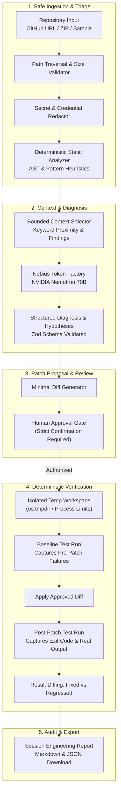

# RepoMedic AI

> **"Understand the bug. Trace the evidence. Propose a minimal fix. Prove what actually passed."**

Built for the **NVIDIA × Nebius Global AI Hackathon**.

RepoMedic AI is an evidence-driven repository debugging and repair system. Unlike chatbots that produce confident conversational explanations, RepoMedic treats code repair as an auditable engineering pipeline: deterministic static analysis, bounded context selection, hypothesis ranking with strict source citations, human-approved minimal diffs, and isolated before-and-after test execution.

---

## Architecture Diagram



---

## Distinctive Features

### 1. Evidence Graph with Valid Source Links
Every diagnosis ties together the reported symptom, concrete file and line ranges, causal relationships, and supporting/contradicting evidence. Observed facts are cleanly distinguished from model hypotheses and static analysis findings.

### 2. Competing Root-Cause Hypotheses
When multiple interpretations are plausible, RepoMedic produces up to three ranked hypotheses with confidence rationales in plain English (never calibrated fake probabilities) and suggests distinguishing inspections or tests.

### 3. Human Approval Gate
RepoMedic never modifies your original repository. Proposed patches require deliberate human review and confirmation before being applied to a temporary, isolated workspace.

### 4. Deterministic Verification
The core differentiator: test results come from actual test execution, never from model claims. RepoMedic runs baseline checks, applies the patch in isolation, re-runs tests, captures real exit codes and stdout/stderr, and categorizes pre-existing failures vs patch-introduced regressions.

### 5. Production Safety Architecture
- Path traversal and malicious symlink prevention on ZIP ingestion.
- Credential detection and automatic redaction before model context assembly.
- Execution limited to allowlisted test runners (`npm test`, `npx vitest run`, `npx jest`).
- Subprocess CPU, RAM, and time limits with token stripping.

---

## AI Infrastructure: Nebius × NVIDIA

- **Inference Provider:** Nebius Token Factory (`https://api.tokenfactory.nebius.com/v1`)
- **Primary Model:** `nvidia/Llama-3.1-Nemotron-70B-Instruct-HF` (NVIDIA open-source model optimized for reasoning and agentic workflows)
- **Output Validation:** Strict runtime Zod schema enforcement on all model responses (`DiagnosisResultSchema`, `PatchProposalSchema`).
- **Resilience:** Automatic retry with exponential backoff on rate limits (`429`), timeouts, and structured error classification (`ModelProviderError`).
- **Demo Mode:** When credentials are not supplied, the platform falls back to a clearly-labeled deterministic demo mode without pretending to make live calls.

---

## Quick Start

### Prerequisites
- Node.js v20+ (v24 recommended)
- npm v10+

### 1. Clone & Install
```bash
git clone https://github.com/vaibhav1874/Repo_medic.git
cd Repo_medic
npm install
```

### 2. Configure Environment Variables
Copy `.env.example` to `.env`:
```bash
cp .env.example .env
```

Edit `.env` with your Nebius Token Factory credentials:
```env
NEBIUS_API_KEY=your_nebius_api_key_here
NEBIUS_BASE_URL=https://api.tokenfactory.nebius.com/v1
NEBIUS_MODEL_ID=nvidia/Llama-3.1-Nemotron-70B-Instruct-HF
PORT=3001
VITE_API_BASE_URL=http://localhost:3001
```

*(If `NEBIUS_API_KEY` is omitted, RepoMedic runs in clearly-labeled Demo Mode).*

### 3. Run Development Servers
```bash
# Starts both Express backend (port 3001) and Vite frontend (port 5173)
npm run dev
```

Open your browser to:
**http://localhost:5173**

---

## Verification & Testing

Run the full automated test suite (unit tests, security tests, schema validation, test runner allowlist):
```bash
npm test
```

---

## Honest Safety Limitations

1. **Advisory Network Isolation:** On Windows/local Node.js environments, network isolation during test runs uses process environment restrictions. Kernel-level network namespaces (`--network=none`) require Docker in production.
2. **Test Framework Execution:** Test runners execute repository test files. While shell commands are strictly allowlisted, untrusted test scripts could execute arbitrary Node.js code within the temporary workspace.
3. **Model Non-Determinism:** LLM reasoning can vary across temperatures. RepoMedic mitigates this through low temperature (`0.2`), deterministic static analysis, and programmatic test verification.

---

## Hackathon Demo Walkthrough (for Judges)

1. Open **http://localhost:5173**.
2. Click **"Try Sample Project"** (loads the bundled buggy calculator module).
3. Notice the reported bug symptom: *"The sum function calculates wrong totals on arrays and the divide function crashes on zero."*
4. Click **"Begin Evidence-Driven Diagnosis"**.
5. **Analysis Tab:** Review the 3-pane workspace with the file tree, deterministic static findings (identifying line 14 loop index), and the code viewer.
6. **Investigation Tab:** Review the root cause diagnosis powered by NVIDIA Nemotron, competing hypotheses, confidence rationales, and concrete evidence links.
7. **Patch Review Tab:** Inspect the minimal unified diff and targeted regression test. Click **"Approve Patch"** and confirm the authorization modal.
8. **Verification Tab:** Click **"Run Verification Now"**. Watch actual Vitest output demonstrate **2 Failed tests before the patch → 0 Failed (5 Passed) tests after the patch**.
9. **History & Report Tab:** Download the comprehensive engineering audit report in Markdown or JSON format.

---

## License
Apache-2.0
